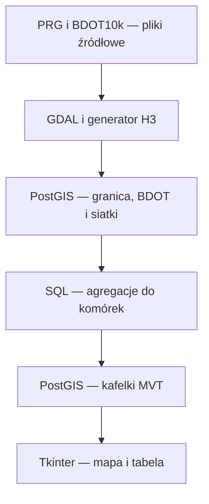

# Architektura i odpowiedzialność plików

## Dwa odrębne procesy

**Przygotowanie danych** jest wykonywane skryptami Pythona/GDAL oraz SQL. Tworzy i aktualizuje dane w PostGIS. **Przeglądanie danych** odbywa się w natywnej aplikacji Tkinter na Windowsie. GUI nie uruchamia importu ani agregacji i korzysta z połączeń tylko do odczytu.

Widoki 2180 i 3857 są sposobami udostępniania geometrii z tych samych tabel. Nie są kolejnym etapem agregacji ani oddzielną kopią całej analizy.

## Pliki przygotowania danych

| Ścieżka od katalogu repo | Odpowiedzialność |
|---|---|
| `data/powiat.*` | Granica PRG; SHP wraz z DBF, SHX, PRJ i pozostałymi plikami towarzyszącymi. |
| `data/bdot/` | Rozpakowane źródła BDOT10k właściwego powiatu; duża paczka dostarczana osobno. |
| `app/python/h3_generator.py` | Czyta granicę, transformuje do 4326, generuje H3 r6/r7/r8 z trybem overlap, zapisuje GeoJSON. |
| `output/h3_r6.geojson` i analogiczne | Wygenerowane pełne komórki przecinające granicę powiatu. |
| `app/load.py` | Importuje granicę i trzy siatki przez ogr2ogr do wybranego portu; transformuje do 2180; tworzy GiST. Używa overwrite. |
| `app/python/load_bdot.py` | Importuje SHP z data/bdot do env-test, normalizuje nazwy tabel, naprawia geometrię, transformuje do 2180 i tworzy GiST. |
| `app/aggregate_bdot.sql` | Dodaje i oblicza kolumny powierzchni, długości i liczby obiektów w trzech siatkach. |
| `app/create_grid_crs_views.sql` | Tworzy aliasy _2180 i widoki z transformowaną geometrią _3857. |

Nazwa rozdzielczości H3 i układ współrzędnych mają inne znaczenie: `h3_r8_3857` to rozdzielczość H3 8, geometria wyświetlana w EPSG:3857.

## Pliki środowiska

| Plik | Rola |
|---|---|
| `docker/postgis/Dockerfile` | Obraz bazy PostGIS. |
| `docker/python/Dockerfile` | Kontener narzędzi Python/GDAL i H3. |
| `docker-compose-local.yml` | Python z montowaniem app, data i output; dodatkowa lokalna baza na 5447. |
| `docker-compose-remote.yml` | Baza danego środowiska; lokalny obraz psip_bs_l1-postgis:latest, osobny wolumen, restart unless-stopped. |
| `.github/workflows/start_services.yml` | Push na env-test/env-qa/main uruchamia odpowiednią bazę na self-hosted runnerze. |
| `.github/workflows/stop_services.yml` | Ręczne zatrzymywanie bazy. |
| `.github/workflows/destroy_services.yml` | Ręczne usuwanie środowiska wraz z wolumenem; nie służy do zwykłego zamknięcia pracy. |

Workflow start nie importuje BDOT, nie przelicza agregacji i nie zapisuje przejezdności. Sam start kontenera nie odtwarza danych usuniętego wolumenu.

Sekrety Environment: POSTGRES_USER, POSTGRES_PASSWORD, POSTGRES_DB, POSTGRES_PORT. Environment dobierany jest według nazwy brancha. Dane bazy nie są częścią historii Git.

## Pliki nowego GUI

| Plik | Rola |
|---|---|
| `gui/main.py` | Interfejs, katalog warstw, zapytania kafelkowe, dekodowanie MVT, rysowanie i tabela danych. |
| `gui/requirements.txt` | Zależności natywnego GUI: psycopg, mapbox-vector-tile, shapely, matplotlib, Pillow. |
| `gui/ensure_spatial_indexes.sql` | Dodaje brakujące GiST na geom i wykonuje ANALYZE. |
| `gui/add_passability.sql` | Dodaje przejezdnosc do bazowych siatek, ogranicza wartości do 0–1, pozostawia NULL. |
| `.venv-gui/` | Lokalne środowisko Windows; nie commitujemy go. |
| `docs/` | Dokumentacja bieżącego stanu i obsługi. |
| `tools/backup_test.ps1` | Zapis kopii bazy env-test poza Gitem. |

## Przebieg żądania mapy

1. Użytkownik wybiera warstwę z geometry_columns.
2. Program rozpoznaje ID, geometrię, SRID i obecność pola przejezdnosc oraz odczytuje zasięg.
3. Dla znanych aliasów H3 _2180/_3857 wybiera źródłową tabelę h3_r6/r7/r8.
4. Wyznacza kafelki XYZ widoczne na ekranie.
5. PostGIS filtruje obiekty przez indeksowalne geom && obwiednia w SRID źródła.
6. Wybrane geometrie transformuje do 3857, przycina i kwantyzuje ST_AsMVTGeom; ST_AsMVT koduje wynik.
7. Python dekoduje MVT; Matplotlib Agg rysuje kafelek, a Tkinter pokazuje obraz w Canvas.
8. Gotowy obraz pozostaje w pamięci podręcznej. Przesuwanie korzysta z już narysowanych kafelków.

Z bazy przychodzą wektorowe dane MVT. Lokalny etap wyświetlania rasteruje je do obrazu na ekran — nie oznacza to pobierania PNG z serwera. Nie ma dodatkowego serwera HTTP ani komponentu przeglądarkowego.

## Ważniejsze funkcje gui/main.py

| Funkcja / metoda | Znaczenie |
|---|---|
| describe_layer | Metadane warstwy i mapowanie aliasów na źródło. |
| tile_query / fetch_tile | SQL i pobranie jednego kafelka. |
| passability_color | Kolor wartości, szary dla NULL lub nieprawidłowej wartości. |
| paint_tile / collect_parts / polygon_patch | Rysowanie typów geometrii, obrysów i otworów poligonów. |
| add_layer / remove_selected / move_selected | Zarządzanie listą i kolejnością warstw. |
| show_attributes | Stronicowana tabela: 100 wierszy, WKT skrócony w widoku. |
| draw_tiles / process_tiles | Wybór kafelków, cache, kolejka wyników. |
| pan_* / change_zoom / fit_* | Nawigacja mapą. |

Do trzech zadań kafelkowych działa w tle. Wyniki są przekazywane kolejką do głównego wątku Tkinter. Rysowanie Agg ma blokadę, ponieważ Matplotlib nie jest używany równolegle do renderowania. Wynik dla usuniętej warstwy jest odrzucany. Cache jest pamięciowy i znika po zamknięciu GUI.
